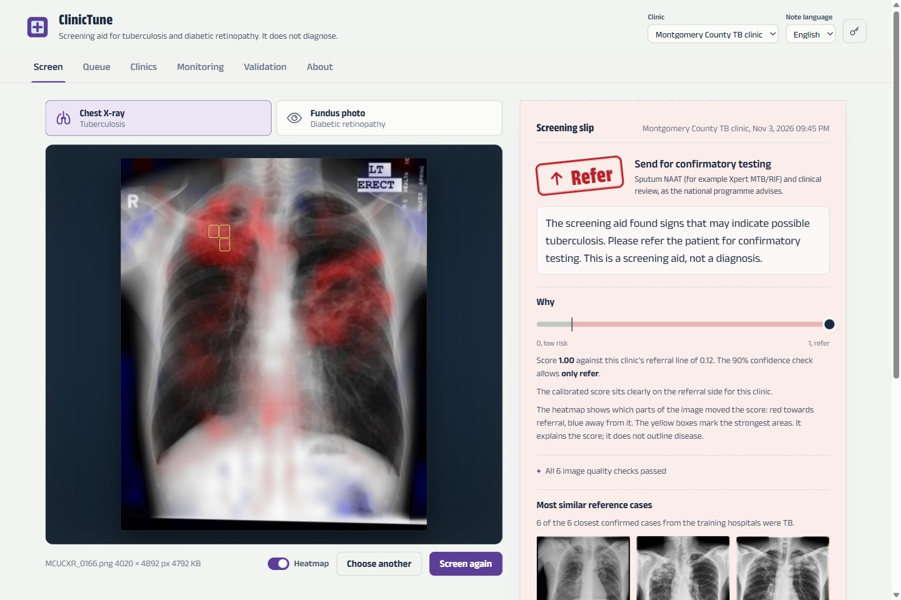
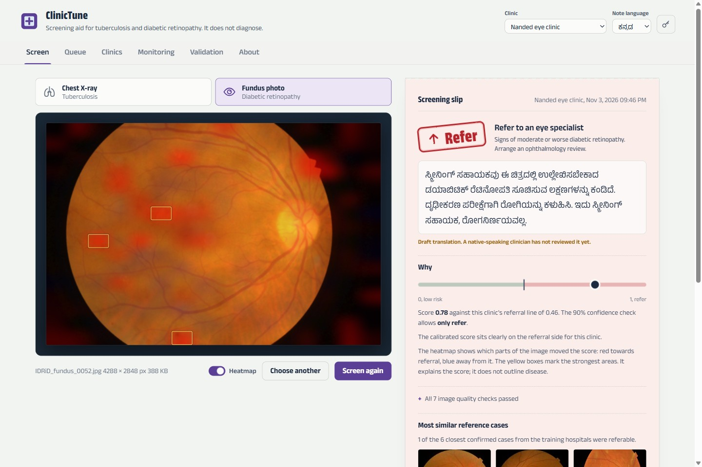
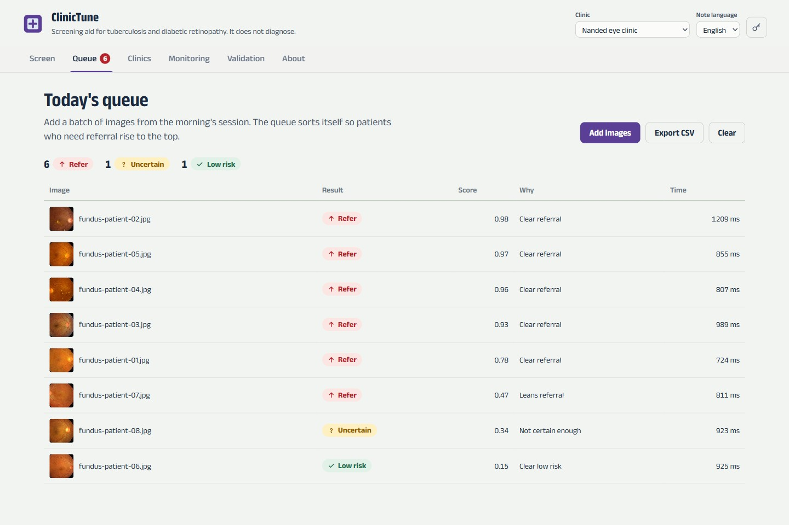
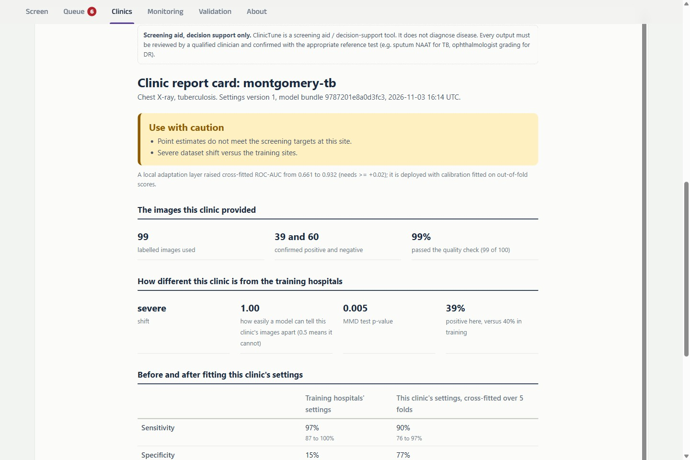

# ClinicTune

**A site-adaptive screening aid for tuberculosis on chest X-rays and diabetic retinopathy on fundus photos,
built for under-resourced clinics.** Neural Storm 2026, HI-01.

ClinicTune reads an image and answers in a way a primary health centre can act on: **Refer**, **Low risk**,
or **Uncertain** (escalate or retake). Each answer comes with the reasons, an exact heatmap, the most similar
confirmed cases, and a plain-language note in English, Hindi or Kannada, printed as a screening slip.

> ClinicTune is a **screening aid and decision-support tool. It does not diagnose disease** and is not a
> medical device. Every output must be reviewed by a qualified clinician and confirmed with the appropriate
> test (sputum NAAT for TB, an ophthalmologist for diabetic retinopathy).

What makes it different is that **it does not trust itself at a new clinic until it has been checked
there.** A clinic uploads 50 to 100 images whose diagnosis was confirmed locally. ClinicTune then:
1. measures how different the clinic is from the training hospitals;
2. shows how badly the unadapted model would have done there;
3. fits the clinic's own settings, and a small adaptation layer when that clearly helps;
4. prints a report card with an honest verdict.



*An unseen chest X-ray from a clinic onboarded with 99 local images. The aid stamps **Refer**. The exact
heatmap concentrates on the upper lung zones, not on the "LT ERECT" or "R" markers. Below the slip are the
most similar confirmed cases. Image: Montgomery County set, U.S. National Library of Medicine.*

| | |
|---|---|
|  |  |
| *A fundus photo from a clinic in Nanded, India, with the note in Kannada. All seven quality checks passed, including the learned gradability model. Image: IDRiD, Porwal et al., CC BY 4.0.* | *A morning's batch sorts itself so referrals rise to the top.* |



*The report card after onboarding Montgomery County. Specificity was 15% with the training hospitals'
settings; the automatically chosen local adaptation layer brings it to 77% with sensitivity at 89.7%,
cross-fitted.
The verdict still says "use with caution", and why.*

---

## Results on real hospitals

All numbers come from **public datasets from 6 hospitals or hospital networks in China, India and the USA**:
- **TB:** 3,000 chest X-rays from three sources.
- **DR:** 6,278 fundus photos from three sources, plus 2,500 expert image-quality labels.

The protocol is **leave one hospital out**: train on the other hospitals, then test on the held-out one. Each
held-out hospital is split by patient into a pool the "clinic" labels from and a test half that is never
used for fitting. Results are the mean of 10 repeats. The full tables, with standard deviations, are in
[`reports/real/`](reports/real). Reproduce everything with [`scripts/reproduce.sh`](scripts/reproduce.sh).

### Tuberculosis: RAD-DINO chest X-ray encoder, CPU only

| Held-out hospital | ROC-AUC, unseen | 90% guarantee before (neg / pos) | After onboarding (neg / pos) | ROC-AUC with local adaptation | Sensitivity / specificity after |
|---|---|---|---|---|---|
| Shenzhen, China | 0.82 | **31% / 72%** fails | 92% / 90% | **0.94** (100 labels) | 0.90 / 0.81 |
| TBX11K hospitals, China | 0.82 | **48% / 83%** fails | 94% / 96% | **0.97** (100 labels) | **0.95 / 0.82** |
| Montgomery County, USA | 0.73 | **4% / 97%** fails | 92% / 91% | **0.89** (50 labels) | 0.88 / 0.59 |

The **WHO target product profile for a TB triage test** asks for sensitivity of at least 90% and
specificity of at least 70%. After onboarding, the aid meets it at TBX11K with 100 labels (94.5% / 82.4%)
and at Shenzhen with 50 labels (91.8% / 73.8%). At Shenzhen with 100 labels it lands just under on
sensitivity (89.8% / 80.7%), and Montgomery, with only 138 images, does not reach it (87.9% / 59.5%). These
are means of 10 repeats; the report card shows each clinic's 95% intervals.

### Diabetic retinopathy: DINOv2-base, CPU only

| Held-out hospital | ROC-AUC, unseen | 90% guarantee before (neg / pos) | After onboarding (neg / pos) | ROC-AUC with local adaptation | Sensitivity / specificity after |
|---|---|---|---|---|---|
| Aravind Eye Hospital, India (APTOS) | 0.94 | **49%** / 99% fails | 90% / 90% | **0.97** | 0.83 / 0.93 |
| DDR, 147 hospitals, China | 0.88 | 94% / **42%** fails | 91% / 90% | **0.90** | 0.84 / 0.78 |
| IDRiD, Nanded, India | 0.94 | **61%** / 96% fails | 92% / 92% | **0.94** | 0.86 / 0.85 |

### What the experiments show, including what went wrong

- **A model that ranks well can still be dangerous at a new hospital.** At DDR the unadapted DR model has
  ROC-AUC 0.88, but its sensitivity is **0.38**: it would miss most patients who need an eye specialist.
  The training hospitals' 90% confidence guarantee failed at **all six** held-out hospitals, three for TB
  and three for DR. Onboarding with 50 to 100 local labels brought every one back to 90% to 96% coverage.
- **Recalibration fixes calibration, not ranking.** Platt scaling is monotone, so it can't change ROC-AUC.
  ClinicTune's **local adaptation layer** can: TB ROC-AUC went 0.82 → 0.94 at Shenzhen and 0.82 → 0.97 at
  TBX11K. Onboarding deploys it only when it beats recalibration by a clear, cross-fitted margin.
- **Starting from the training hospitals beats starting from scratch when labels are scarce.** With 50 local
  labels, the adaptation layer reached mean ROC-AUC 0.924 (TB) and 0.928 (DR); a model trained only on those
  labels reached 0.909 and 0.905. At 100 labels the gap narrows (TB 0.955 vs 0.958, DR 0.936 vs 0.927).
- **Calibration error drops sharply after onboarding.** Expected calibration error fell from 0.54 to 0.11
  at Montgomery and from 0.26 to 0.04 at DDR.
- **Negative result: the guarantee does not hold equally for women.** At Shenzhen, after recalibration with
  100 labels, coverage for TB-positive women was **82%** (sensitivity 0.80), against 94% (sensitivity 0.93)
  for men. This is the failure Boman et al. (2026) warn about: class-conditional calibration is not
  subgroup-conditional. The Validation page shows it in red, and per-subgroup calibration is on the roadmap.
- **A domain model matters for chest X-rays.** On unseen TB hospitals, mean ROC-AUC was 0.59 for
  DINOv2-small, 0.68 for DINOv2-base and **0.79 for RAD-DINO**. For fundus photos the general-purpose
  DINOv2-base was enough: mean 0.92.
- **It reads the lungs, not the markings on the film.** At Montgomery, which the model never trained on,
  ROC-AUC falls from 0.71 to **0.50 (chance) when both lung fields are blanked** with the hospital's manual
  lung masks, and to 0.52 when only the border is left. Border-only scores at the training hospitals are
  0.39 and 0.63. Trimming the border *raises* Montgomery's ROC-AUC to 0.80, so its markers distract rather
  than help.
- **We found a shortcut in the fundus data, and fixed it.** With the whole retina blanked out, the first DR
  model still separated referable from non-referable photos at APTOS (ROC-AUC 0.77) and IDRiD (0.67). The
  cause: in APTOS, the size, position and shape of the retinal field (which reveal the camera) predict
  referable DR **on their own** with ROC-AUC 0.85, because different cameras saw patients of different
  severity. ClinicTune now standardises every fundus photo before the model sees it: crop to the retinal
  field, centre it in a square, resize, and mask outside the circle. The same step runs in training,
  onboarding and serving, and the heatmap maps back onto the original photo. After the fix, the
  retina-blanked score is **0.63 at APTOS, 0.55 at DDR and 0.49 at IDRiD**, all under our 0.65 flag; APTOS
  keeps a little, plausibly from fields the camera cut off at the top or bottom. Unseen-hospital ROC-AUC fell
  only at APTOS (0.954 → 0.938), where the shortcut lived, and rose at DDR (0.870 → 0.875) and IDRiD
  (0.928 → 0.938). We also corrected the test itself along the way: it first filled the blanked retina with
  the retina's own median colour, which leaks overall colour; it now uses a constant fill.

### Choosing a model that runs on a clinic laptop

Every candidate went through the same leave-one-hospital-out test and was timed on a laptop CPU
(Intel Core Ultra 5 225H, no GPU, ONNX Runtime):

| Image model | Input | CPU time per image (median of 20) | Unseen-hospital ROC-AUC, mean | Used for |
|---|---|---|---|---|
| RAD-DINO (chest X-ray foundation model) | 518 px | 1,170 ms | not run (392 px is 2.3x faster) | |
| **RAD-DINO** | **392 px** | **513 ms** | **0.79** (TB) | **TB** |
| DINOv2-base | 224 px | 93 ms | 0.68 (TB), **0.92 (DR)** | **DR** |
| DINOv2-small | 224 px | 34 ms | 0.59 (TB), 0.91 (DR) | |

A full screening, from decoding a 20-megapixel X-ray through the quality gate and heatmap, takes about
2 seconds on this laptop. The serving image needs no GPU and no PyTorch.

---

## What a clinic gets

| | |
|---|---|
| **Screen** | Drop, choose or paste an image. Rule-based quality checks run first (blur, exposure, wrong modality, both lung fields visible); for fundus photos a **learned gradability model** trained on DDR's expert quality labels runs too: on held-out DDR images it catches 94% of ungradable photos while keeping 95% of gradable ones (ROC-AUC 0.98). Then the image is checked for familiarity, scored with the clinic's calibration, given a 90% class-conditional confidence check, and stamped onto a printable slip with the next step, an exact heatmap, the six most similar confirmed reference cases, and the note in the chosen language. |
| **Queue** | Screen a whole morning's batch. The queue sorts itself so referrals rise to the top, and exports to CSV. |
| **Clinics** | Register a clinic and onboard it with a zip of locally confirmed images. Watch the five onboarding steps run, then read the report card: shift test, before and after with 95% intervals, the two adaptation strategies compared, a verdict and warnings. Every onboarding is a new version, and you can roll back. |
| **Monitoring** | Results per day, referral, uncertain and quality-failure rates, and observed sensitivity and specificity once confirmatory results are entered. **Alerts** fire on unfamiliar images (equipment change), quality failures, a significant shift in referral rate (two-proportion test), and any confirmed-positive patient who was called low risk. The screening log downloads as CSV. |
| **Validation** | The evidence above, rendered from the model bundle: per-hospital charts, coverage before and after, every number, backbone comparison, shortcut tests and subgroups. |

### How the decision is made

```
quality gate failed (rules or learned gradability)  -> Uncertain: retake
image unlike anything this clinic was calibrated on -> Uncertain: escalate
confidence set = {refer}                            -> Refer
confidence set = {refer, low risk}, score >= line   -> Refer   (sensitivity first)
confidence set = {low risk}, score < line           -> Low risk
anything else                                       -> Uncertain: escalate
```

"Low risk" needs the score and the confidence check to agree, because missing disease is the costlier error.

### Heatmaps that are exact

The image embedding is the mean of the backbone's patch tokens, and every layer on top of it (the training
head and the clinic's adaptation layer) is linear. The score therefore splits **exactly** into per-patch
contributions, computed in one forward pass. The heatmap explains this model's score; the UI states that it
does not outline disease.

---

## Architecture

```
offline, once                                         serving, CPU only
──────────────────────────────────────────            ─────────────────────────────────────────────────
clinictune fetch      public data, resumable         upload ─► quality gate (rules + learned gradability)
clinictune export     RAD-DINO / DINOv2 ─► ONNX            ─► task backbone (ONNX Runtime, sha256-pinned)
clinictune loso       leave-one-hospital-out               ─► familiarity check (embedding OOD)
clinictune train      heads, calibration, conformal,       ─► head + clinic adaptation layer + Platt
                      OOD, gradability, case library       ─► class-conditional conformal ─► decision
clinictune shortcut   border / lungs / retina blanked      ─► exact heatmap, similar cases, note (en/hi/kn)
clinictune evidence   validation tables into bundle   SQLite: clinics, settings versions, jobs, audit log
```

| Path | What |
|---|---|
| `src/clinictune/data/` | Reproducible fetcher, loaders (with sex and age from clinical readings, and lung masks), patient-level splits with leakage checks, the **licence registry** |
| `src/clinictune/embed/` | ONNX backbone contract, exporter for RAD-DINO, DINOv2 and MedSigLIP, embedding cache |
| `src/clinictune/model/` | Linear heads, MAP Platt calibration, class-conditional conformal, **local adaptation layer**, shift tests, OOD, metrics, bundle format |
| `src/clinictune/site/` | Onboarding (shift → before → two cross-fitted strategies → deploy), zip ingestion, report card |
| `src/clinictune/experiments.py` | Leave-one-hospital-out, subgroup analysis, shortcut tests |
| `src/clinictune/api/` | FastAPI service, SQLite store, monitoring and alerts |
| `web/` | No-build UI: lightbox and screening slip, self-hosted Anek fonts (Latin, Devanagari, Kannada), works offline |

Embeddings for training are extracted **with the same ONNX model and preprocessing code used in production**,
so there is no train/serve skew.

---

## Run it

### Real model (about 2 to 3 hours on a CPU, about 12 GB download)

```bash
bash scripts/reproduce.sh
```

```bash
CLINICTUNE_BUNDLE_DIR=models/clinictune-v1 uv run clinictune serve
```

Open http://localhost:8000. To try onboarding, register a clinic and upload `data/onboarding/idrid-dr.zip`
(IDRiD, India, held out from training) or `data/onboarding/montgomery-tb.zip`. Then screen images from the
matching `_unseen` folder, which the clinic's settings never saw. File names start with the true label.

### Five-minute synthetic demo (no downloads)

```bash
uv sync
```

```bash
uv run clinictune demo
```

```bash
uv run clinictune serve
```

The demo uses cartoon images and a random-projection backbone. It exercises every code path, means nothing
clinically, and the UI says so on every page.

### Deploy

```bash
CLINICTUNE_BUNDLE=clinictune-v1 docker compose up -d --build
```

Set `CLINICTUNE_API_KEY` first; Compose refuses to start without it. `CLINICTUNE_BUNDLE` names the folder
under `models/` to mount; it defaults to the synthetic `demo` bundle.

- **Image:** python:3.12-slim with ONNX Runtime on CPU. No PyTorch, runs as a non-root user with a read-only
  filesystem and all capabilities dropped, and has a health check.
- **Bundle:** mounted read-only and pinned by sha256, so tampered weights refuse to load.
- **Privacy:** images are processed in memory and never stored. The audit log keeps only a fingerprint, the
  decision and the versions used.
- **HTTP:** strict Content-Security-Policy, bounded uploads, and zip ingestion that resists zip-slip and
  zip bombs.
- **Operations:** Prometheus metrics; rollback of any clinic's settings; an offline-capable UI.

### API

| Method | Path | |
|---|---|---|
| GET | `/healthz`, `/readyz`, `/metrics` | liveness, readiness, Prometheus |
| GET | `/v1/info`, `/v1/evidence` | bundle, tasks and backbones; validation evidence |
| POST | `/v1/screen` | multipart `file`, `task` (tb or dr), optional `site_id`, `lang` (en, hi, kn) |
| POST | `/v1/screenings/{id}/outcome` | record the confirmatory test result |
| GET, POST | `/v1/sites` | list or register clinics |
| POST | `/v1/sites/{id}/onboard` | onboarding pack (zip) as a background job; poll `/v1/jobs/{job_id}` |
| GET | `/v1/sites/{id}/report[.html]` | report card, any version |
| POST | `/v1/sites/{id}/calibrations/{task}/{version}/activate` | roll back or forward |
| GET | `/v1/sites/{id}/monitoring`, `/v1/sites/{id}/screenings.csv` | monitoring with alerts; screening log |

OpenAPI docs are at `/docs`.

### Development

```bash
uv run pytest
```

```bash
uv run ruff check src tests
```

The tests cover:
- per-class conformal coverage, and sets that never exclude a class when it has too few labels;
- calibration with a prior, and the residual adaptation layer fixing a flipped feature;
- patient-leakage detection and the exact heatmap decomposition;
- the decision table and the quality gate;
- fundus-field standardisation (two framings of one retina give the same model view), and heatmaps and
  boxes mapped back onto the original photo;
- loaders and clinical-reading parsing;
- monitoring alerts and the CSV export;
- the evidence and pack commands;
- the full API: screen, onboard twice, report, roll back, record an outcome, monitor.

CI also syntax-checks the UI and fails if data or weights are committed.

---

## Limitations

- **No prospective or clinical validation.** These are retrospective results on public data.
- **Small held-out hospitals give wide intervals.** Montgomery has 138 images, so its pool holds 69. The
  report card shows 95% intervals: read those, not the point estimate.
- **The guarantee is per class, not per subgroup.** The Shenzhen gap for women shows this matters.
- **TBX11K, APTOS and DDR release no patient IDs.** There, image is treated as patient. APTOS comes from a
  224 px mirror.
- **Hindi and Kannada notes are drafts.** A native-speaking clinician has not reviewed them, and the API and
  UI say so.
- **Quality-gate rules are heuristic.** The learned gradability model covers fundus photos only.
- **Licences need a human sign-off.** Every source is recorded and was read on 2026-11-03, but
  [`datasets.yaml`](src/clinictune/data/datasets.yaml) stays `verified: false` until someone on the team
  signs off. TBX11K and APTOS are research-use only.

## Roadmap

- Per-subgroup conformal calibration once a clinic has enough labels per group.
- A learned CXR view and quality classifier (PA, AP or lateral; rotation; inspiration).
- MedSigLIP and RETFound backbones (the exporter supports them; they need gated access).
- Review of the Hindi and Kannada notes by native-speaking clinicians.

## Licences

Code: Apache-2.0. Fonts: Anek by Ek Type, SIL Open Font License (`web/fonts/OFL.txt`). Datasets and model
weights keep **their own** terms; see [docs/DATASETS.md](docs/DATASETS.md). No data or weights are
distributed with this repository.
